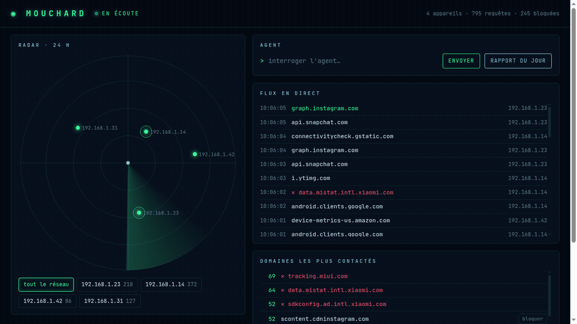

# mouchard

**A home DNS server that shows who every device on your network is talking to, and an AI agent that explains it in plain words.**

*Mouchard* is French for "snitch": your smart TV, phone and speakers report to dozens of servers every hour. This one reports on them.



<sub>Demo recorded with simulated devices.</sub>

## What it does

- **Logs every DNS lookup, per device.** Point your network at mouchard and every domain each device looks up is recorded, over UDP and TCP.
- **Radar dashboard.** Each device is a blip: the busier it is, the closer it sits to the centre, and it pings on every new request. Devices show their maker (read from the MAC address) until you give them a name.
- **Who is behind each domain.** The company and what it does (advertising, analytics, social…) from the Disconnect tracker list, and the country of the server it answered from.
- **Blocks trackers.** About 80,000 ad and tracking domains from StevenBlack/hosts, updated weekly, plus your own `bloquer.txt`. Block or unblock any domain in one click; nothing needs a restart.
- **An agent that acts, with your permission.** Ask it anything ("which device talks to trackers the most?", "what was my TV doing at 3 am?"). Its daily report comes with suggestions to block, each with a reason: one click in the dashboard, or a button on Telegram.
- **Safe suggestions.** The agent can only suggest domains from a stricter curated list (Hagezi Pro) that are not blocked yet. When the model tried to suggest Android's connectivity check, this rule threw it out.
- **New device alert** on Telegram, and a 30-day history, purged automatically.

## How it works

```
 devices ──DNS──▶ mouchard.py ──▶ cache ──▶ upstream DNS (1.1.1.1 or your router)
                      │
                      ├─ blocked? ─▶ NXDOMAIN
                      ▼
                  mouchard.db (SQLite) ◀── web.py + page.html (dashboard, port 8053)
                                       ◀── resume.py ──▶ Gemini ──▶ report + suggestions
                                       ◀── messager.py ◀──▶ Telegram (alerts, buttons, questions)
```

Plain Python 3 standard library: no dependencies, no framework. The DNS part only parses what it needs and forwards the raw packet, so answers are exactly what the upstream server sent. The lists and data files are downloaded into `listes/` at startup and refreshed in the background.

## Quick start

Try it on your own machine, without touching your network:

```sh
python3 mouchard.py                      # DNS on 127.0.0.1:5300, dashboard URL printed at start
dig @127.0.0.1 -p 5300 example.com       # the lookup appears on the dashboard
python3 test_mouchard.py                 # tests
```

To see your own computer's traffic on Linux with systemd-resolved (replace `wlan0` with your interface):

```sh
sudo resolvectl dns wlan0 127.0.0.1:5300   # route this machine's DNS through mouchard
sudo resolvectl dns wlan0 <your router>    # undo
```

## On a home server

Run it on an always-on machine (an old laptop works fine) and listen on the network:

```sh
sudo MOUCHARD_ECOUTE=0.0.0.0 MOUCHARD_PORT=53 python3 mouchard.py
```

Then set that machine's IP as the DNS server in your router's DHCP settings, or device by device. Every device then shows up on the radar.

| Variable | Default | Meaning |
|---|---|---|
| `MOUCHARD_ECOUTE` | `127.0.0.1` | Address to listen on (`0.0.0.0` for the whole network) |
| `MOUCHARD_PORT` | `5300` | DNS port (`53` on a server) |
| `MOUCHARD_PORT_WEB` | `8053` | Dashboard port |
| `MOUCHARD_AMONT` | `1.1.1.1` | Upstream DNS server |
| `MOUCHARD_MODELE` | `gemini-3.1-flash-lite` | Gemini model used by the agent |
| `MOUCHARD_LANGUE` | `English` | Language of the daily report (questions are answered in the language they are asked in) |
| `MOUCHARD_LISTE_URL` | StevenBlack/hosts | Blocklist applied to everyone (empty to disable) |
| `MOUCHARD_CANDIDATS_URL` | Hagezi Pro | Stricter list the agent may pick suggestions from |

**AI agent:** put a [Gemini API key](https://aistudio.google.com/apikey) in `~/.config/mouchard/cle` (`chmod 600`) or in `GEMINI_API_KEY`.

**Telegram:** create a bot with [@BotFather](https://t.me/BotFather), put its token in `~/.config/mouchard/telegram` (`chmod 600`), start mouchard and send `/start` to your bot: the first chat that writes to it becomes its owner, and it ignores everyone else. Then you get alerts, the report with Block / Ignore buttons, and you can ask questions in the chat (`/report` for the report on demand). Schedule the report with cron or a systemd timer: `python3 resume.py`.

## Privacy and security

- The DNS log is a browsing history. The dashboard refuses every request without the token stored in `~/.config/mouchard/jeton` (created on first run).
- Domain names come from the network and are never inserted as HTML in the page.
- The data stays on the machine, except the last 24 hours of domains sent to Gemini when the agent answers or writes the report, and the messages exchanged with your own Telegram bot.
- The Telegram bot only listens to the chat it was paired with.
- **Only run mouchard on a network you own.** Logging other people's traffic on a school, office or public network without permission is illegal in most countries.

## Files

| File | Role |
|---|---|
| `mouchard.py` | DNS server (UDP and TCP): cache, block, log, list updates |
| `web.py`, `page.html` | Dashboard and its API |
| `resume.py` | The agent: daily report and suggestions (`--ecran` prints them instead of sending them) |
| `qui.py` | Company, activity and server country of a domain |
| `messager.py` | Telegram: alerts, buttons, questions |
| `bloquer.txt` | Your own blocklist, one domain per line |
| `test_mouchard.py` | Tests |

## Credits

[StevenBlack/hosts](https://github.com/StevenBlack/hosts) (blocklist) · [Hagezi DNS blocklists](https://github.com/hagezi/dns-blocklists) (suggestions) · [Disconnect tracker list](https://disconnect.me/trackerprotection) (companies) · [IP Geolocation by DB-IP](https://db-ip.com) (countries, CC BY 4.0) · maker names from the IEEE OUI list (`hwdata` package).

## License

MIT
